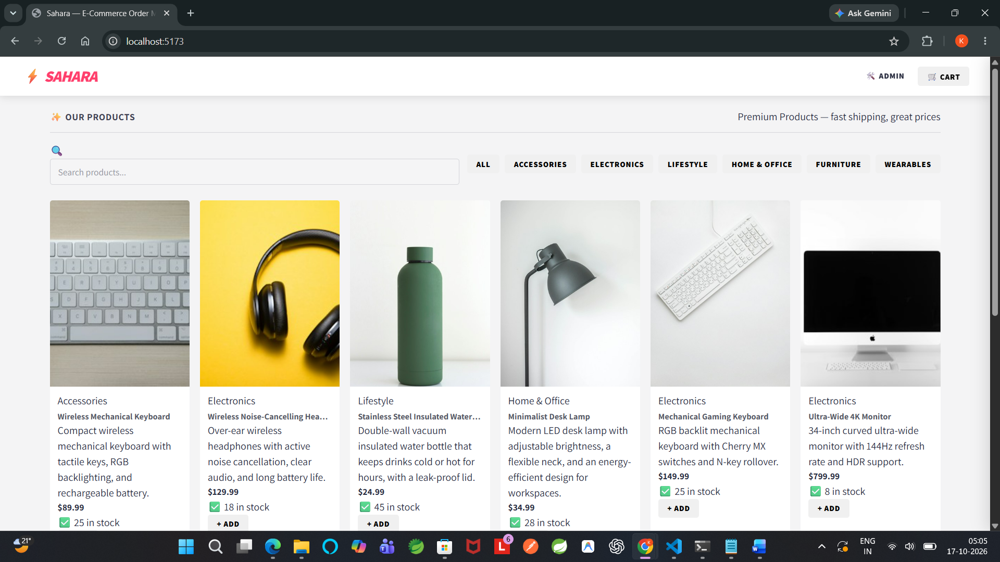
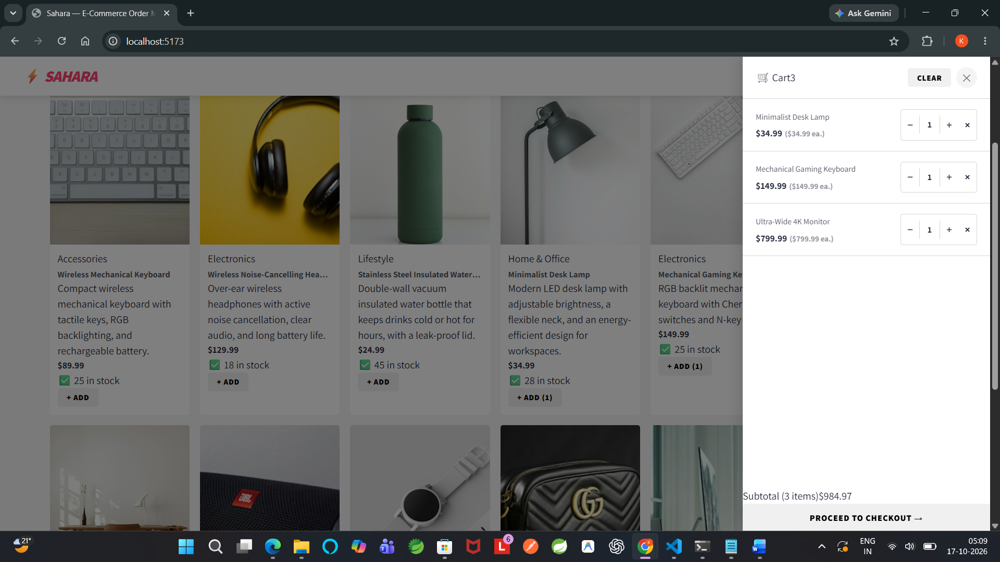
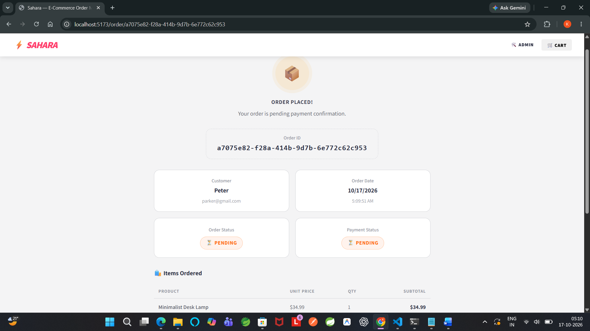
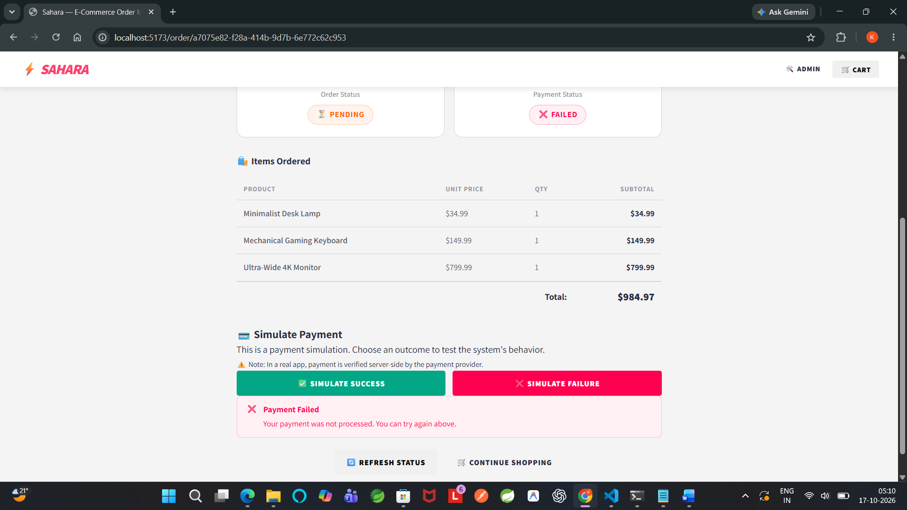
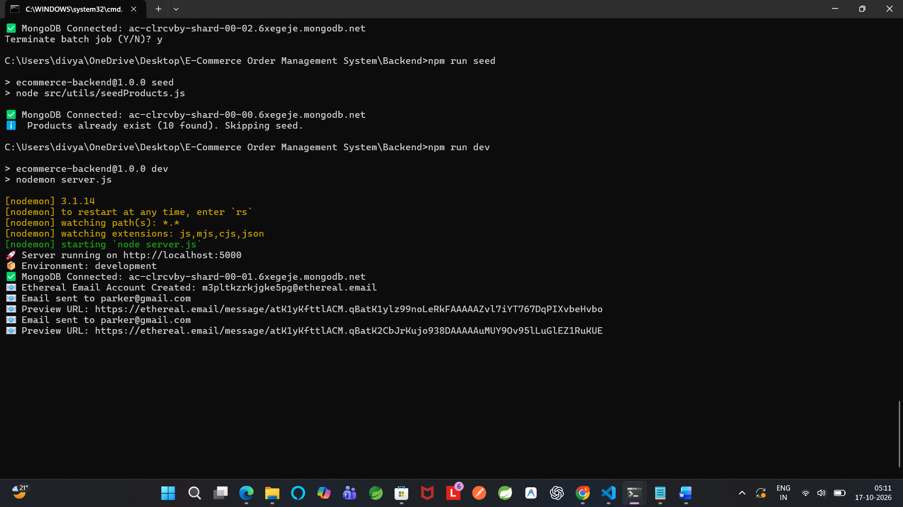
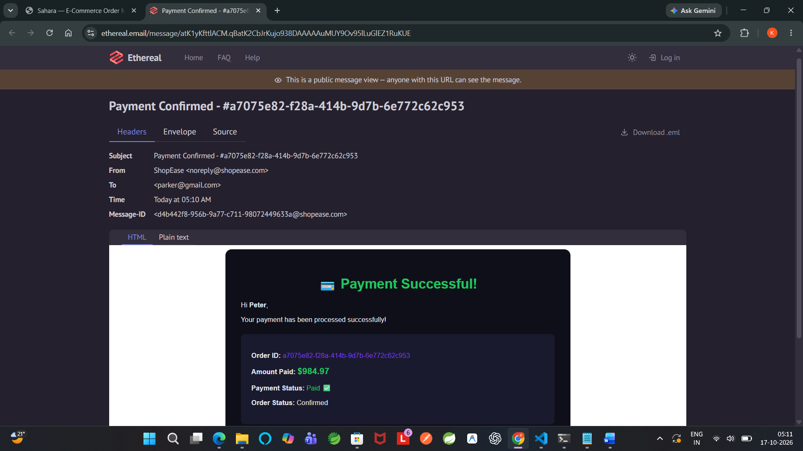
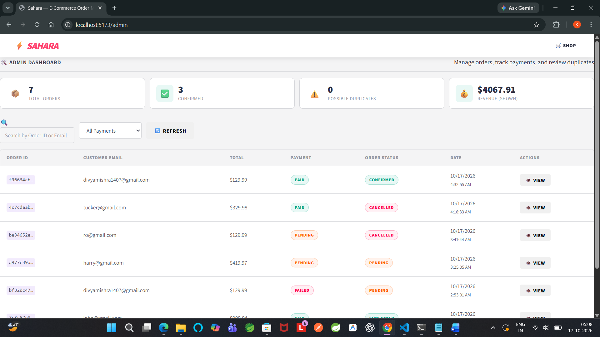

# ⚡ ShopEase — E-Commerce Order Management System

A full-stack MERN (MongoDB, Express, React, Node.js) e-commerce application with duplicate-order protection, simulated payment, admin dashboard, and email notifications.

---

## 🚀 Quick Start

### Prerequisites
- Node.js v18+ and npm
- A MongoDB Atlas account (free tier works perfectly)

---

## ⚙️ Backend Setup

Clone the Repository

>git clone https://github.com/YOUR_USERNAME/mern-shopping-app.git
>cd mern-shopping-app
Replace YOUR_USERNAME with your GitHub username.


### 1. Install dependencies
```bash
cd Backend
npm install
```

### 2. Configure environment variables
Edit `Backend/.env` with your MongoDB Atlas URI:
```env
PORT=5000
MONGODB_URI=mongodb+srv://<username>:<password>@cluster0.xxxxx.mongodb.net/ecommerce?retryWrites=true&w=majority
NODE_ENV=development
FRONTEND_URL=http://localhost:5173
```

> **How to get your MongoDB Atlas URI:**
>Step 1: Open MongoDB Atlas
Go to MongoDB Atlas and sign in or create an account.
>Step 2: Create a free cluster
1. Open your Atlas project.
2. Choose the option to create a database or cluster.
3. Select the available free cluster option (often called M0 Free).
4. Choose a cloud provider and region.
5. Give the cluster a name, such as Cluster0.
6. Click Create and wait for it to finish.
Atlas screens and button names may vary slightly depending on the current interface.
>Step 3: Create a database user
1. Open Security → Database Access.
2. Click Add New Database User.
3. Choose password authentication.
4. Create a username and a strong password.
5. Give the user the minimum database permissions needed for your application, such as read/write access to your project database.
6. Save the user.
>Step 4: Add your IP address
1. Open Security → Network Access (sometimes shown as IP Access List).
2. Click Add IP Address.
3. For local development, choose Add Current IP Address.
4. Save and wait for the change to take effect.
You can use 0.0.0.0/0 temporarily for testing from changing IP addresses, but it allows connections from any IP address. Prefer your current IP or a restricted list. Database credentials are still required.
>Step 5: Copy your MongoDB connection string
1. Open your cluster's page.
2. Click Connect.
3. Select Drivers or Connect your application.
4. Choose Node.js and the appropriate driver version if prompted.
5. Copy the connection string.
It will resemble:
mongodb+srv://<username>:<password>@cluster0.xxxxx.mongodb.net/?retryWrites=true&w=majority

Replace <username> and <password> with the database user's credentials. If the password contains special characters, URL-encode them in the connection string.

### 3. Seed the database with sample products
```bash
npm run seed
```

### 4. Start the backend server
```bash
npm run dev
```
Server runs at: `http://localhost:5000`

---

## 🎨 Frontend Setup

### 1. Install dependencies
```bash
cd Frontend
npm install
```

### 2. Start the frontend
```bash
npm run dev
```
App runs at: `http://localhost:5173`

---

## 📧 Email Notifications

This project uses **Ethereal** — a free fake SMTP service. No real email credentials are needed.

When an email is sent, a **preview URL** is logged in the backend console. Open it to see the email exactly as it would appear.

```
📧 Email sent to customer@example.com
📧 Preview URL: https://ethereal.email/message/xxxxx
```

In production, replace the Ethereal transporter in `src/utils/emailService.js` with your real SMTP credentials (Gmail, SendGrid, etc.).

---

## 🛡️ Duplicate Order Protection

The system uses a **two-layer** approach:

| Layer | Mechanism |
|-------|-----------|
| **Frontend** | UUID idempotency key generated per cart session. "Place Order" button disabled immediately on click. |
| **Backend** | `IdempotencyRecord` MongoDB collection checks the key before processing. Returns existing order if key was already used. |

This prevents accidental duplicate orders when a user clicks "Place Order" multiple times. **Intentional** duplicate orders (same products, new session) use different keys and are correctly created — but flagged as "Possible Duplicate" for admin review.

---

## 🗂️ Project Structure

```
E-Commerce Order Management System/
├── Backend/
│   ├── src/
│   │   ├── config/db.js              ← MongoDB Atlas connection
│   │   ├── models/
│   │   │   ├── Product.js            ← Product schema
│   │   │   ├── Order.js              ← Order schema
│   │   │   └── IdempotencyRecord.js  ← TTL-indexed idempotency keys
│   │   ├── middleware/
│   │   │   ├── idempotency.js        ← Duplicate-order middleware
│   │   │   └── errorHandler.js       ← Global error handler
│   │   ├── controllers/
│   │   │   ├── productController.js  ← GET /api/products
│   │   │   ├── orderController.js    ← Order CRUD + payment
│   │   │   └── adminController.js    ← Admin views + status updates
│   │   ├── routes/
│   │   │   ├── productRoutes.js
│   │   │   ├── orderRoutes.js
│   │   │   └── adminRoutes.js
│   │   └── utils/
│   │       ├── emailService.js       ← Nodemailer + Ethereal
│   │       └── seedProducts.js       ← Seed 10 sample products
│   ├── server.js                     ← Express entry point
│   └── .env                          ← ⚠️ Fill in your MongoDB URI
│
└── Frontend/
    ├── src/
    │   ├── api/index.js              ← Axios API client
    │   ├── context/CartContext.jsx   ← Cart state + idempotency key
    │   ├── components/
    │   │   ├── Navbar.jsx
    │   │   ├── ProductCard.jsx
    │   │   └── CartPanel.jsx         ← Cart + checkout flow
    │   └── pages/
    │       ├── ShopPage.jsx          ← Product grid + cart
    │       ├── OrderPage.jsx         ← Order detail + payment sim
    │       └── AdminPage.jsx         ← Admin dashboard
    └── index.html
```

---

## 🌐 API Endpoints

| Method | Endpoint | Description |
|--------|----------|-------------|
| `GET` | `/api/products` | Get all products |
| `POST` | `/api/orders` | Create order (requires `Idempotency-Key` header) |
| `GET` | `/api/orders/:id` | Get order by UUID |
| `POST` | `/api/orders/:id/payment` | Simulate payment (`{ result: "success" \| "failure" }`) |
| `GET` | `/api/admin/orders` | List orders (supports `?search=&paymentStatus=`) |
| `PATCH` | `/api/admin/orders/:id/status` | Update order status |
| `GET` | `/api/admin/orders/possible-duplicates` | Get flagged duplicate orders |

---

## ✅ Test Scenarios Covered

1. **Normal order** — Place order, get order ID, see email preview URL in console.
2. **Multiple clicks** — Button disabled instantly; backend idempotency returns same order.
3. **Page refresh** — Order persists; navigate to `/order/<id>` anytime.
4. **Tampered price** — Backend recalculates from DB; frontend total is ignored.
5. **Failed payment** — `paymentStatus: "Failed"`, order stays `Pending`, can retry.
6. **Intentional duplicate** — Both orders created with different idempotency keys; second flagged as "Possible Duplicate" for admin review.
7. **Confirm cancelled order** — Backend rejects with 400 error.
8. **Email fails** — Order still saved; failure logged to console.
9. **Over-stock order** — Backend returns clear error with available stock info.
10. **Admin duplicate review** — Orange pulsing "Duplicate?" badge; no auto-cancel.

---

## 🎨 Design Features

- 🌙 Dark theme with glassmorphism cards
- 🎨 Purple/cyan gradient accents
- ✨ Micro-animations (card hover, slide-in, bounce)
- 📱 Fully responsive layout
- 🔔 Toast notifications (react-hot-toast)
- 🔍 Product search + category filter
- 🛒 Sticky cart sidebar with live total

---

## 🔑 Key Design Decisions

- **Server-side price calculation**: Frontend totals are completely ignored. Prices are always fetched from MongoDB.
- **Idempotency TTL**: Records auto-delete after 24 hours via MongoDB TTL index.
- **Stock decrement timing**: Stock is decremented only on successful payment confirmation.
- **Possible duplicate**: Informational only — never auto-cancelled. Admin decides.
- **Email resilience**: `try/catch` ensures email failures never block order creation or payment processing.
- **State machine for orders**: `Cancelled → *` transitions are blocked server-side.

---

## 📸 Pages

| Page | URL |
|------|-----|
| Shop | `http://localhost:5173/` |
| Order Detail | `http://localhost:5173/order/<orderId>` |
| Admin Dashboard | `http://localhost:5173/admin` |









<video controls src="20261016-2344-27.7499353.mp4" title="Title"></video>